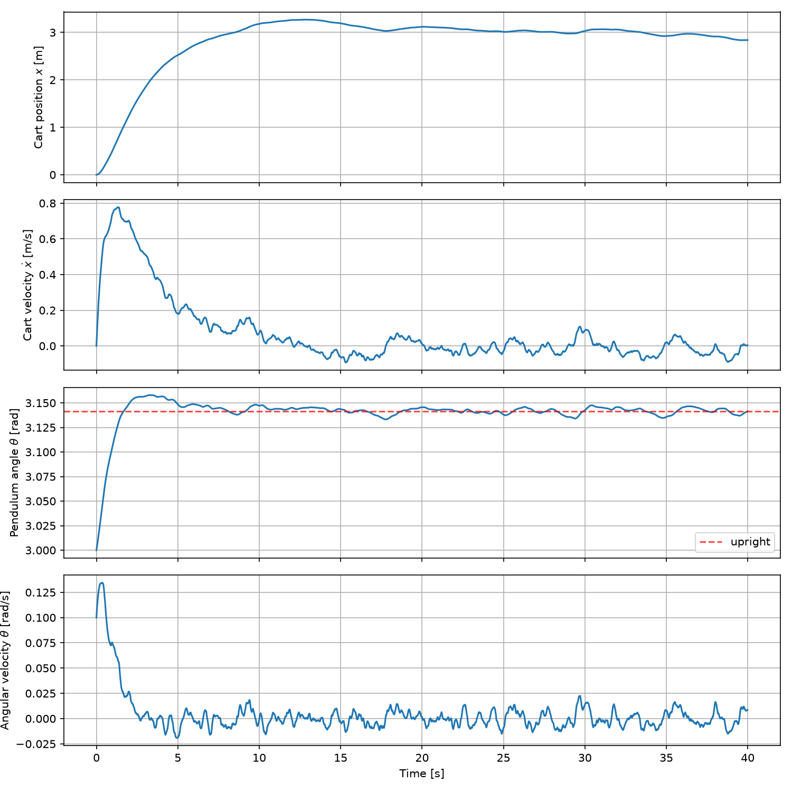

# LQR + Kalman Filter on a Cart-Pole

State-space modeling and optimal control of an inverted pendulum on a cart in Python. A nonlinear cart-pole is simulated, an LQR controller balances it upright, and a Kalman filter reconstructs the full 4-state vector from only two noisy measurements (cart position and pendulum angle). The controller runs on the estimated state, not the true state.

  
<p align="center">
    
</p>


## Overview

- **Plant:** nonlinear cart-pole dynamics, integrated with RK4 (`dt = 0.01 s`, 40 s)
- **Controller:** LQR gain designed on the linearization about the upright equilibrium
- **Estimator:** discrete-time Kalman filter using only `[x, θ]` measurements with sensor noise
- **Closed loop:** `u = −K (x̂ − x_eq)`, where `x̂` is the Kalman filter estimate

## System model

State `z = [x, ẋ, θ, ɵ̇]`, where `x` is the cart position and `θ` is the pendulum angle. The angle convention is `θ = 0` hanging down and `θ = π` upright. The input `u` is the horizontal force on the cart.

Nonlinear dynamics (used by the simulator):

```
F    = u − b·ẋ + m·l·ɵ̇²·sin θ
D    = (M+m)(I + m·l²) − (m·l·cos θ)²
ẍ    = [ (I + m·l²)·F + m²·g·l²·sin θ·cos θ ] / D
θ̈    = [ −m·g·l·(M+m)·sin θ − m·l·cos θ·F ] / D
```

Parameters used in `main.py`:

| Symbol | Meaning | Value |
|--------|---------|-------|
| `M` | cart mass | 5 kg |
| `m` | pendulum mass | 1 kg |
| `l` | pivot to pendulum center of mass | 2 m |
| `g` | gravity | 9.8 m/s² |
| `b` | cart damping | 1.0 N·s/m |
| `I` | pendulum inertia (uniform rod about its center of mass) | `m·l²/3` |

Linearizing about the upright equilibrium `z_eq = [x_ref, 0, π, 0]` gives `ż = A z + B u` with:

```
A = [ 0     1                    0                    0 ]
    [ 0   −(I + m·l²)·b / D     m²·g·l² / D           0 ]
    [ 0     0                    0                    1 ]
    [ 0   −m·l·b / D            m·g·l·(M+m) / D       0 ]

B = [ 0,  (I + m·l²)/D,  0,  m·l/D ]ᵀ
```
where `D = (M+m)(I + m·l²) − (m·l)²`

The open-loop poles are at `0, −0.17, −2.06, +2.04`, so the upright position is unstable (the pole at +2.04 is the pendulum falling).
The pair `(A, B)` is controllable and `(A, C)` is observable (both checked by rank, full rank 4), allowing both the LQR the Kalman filter to work.

## Controller design

### LQR

Minimizes `∫ (zᵀ Q z + uᵀ R u) dt` with

```
Q = diag(1, 1, 3, 2)      R = 10
```

The gain is computed with `control.lqr` and the cart is regulated to a reference position of 3 m:

```
K = [ −0.316  −3.523  140.415  69.307 ]
```

Closed-loop poles: `−2.07`, `−2.03`, and `−0.18 ± 0.14j`. All are in the left half-plane, so the linearized system is stable.

### Kalman filter

The linearized model is discretized with a zero-order hold at `dt = 0.01 s`. At each step the filter predicts with `A, B` and the previous input, then corrects using the measurement `y = [x, θ]`:

```
C = [ 1 0 0 0 ]       process noise   Q_k = diag(1e-4, 1e-3, 1e-4, 1e-3)
    [ 0 0 1 0 ]       sensor noise    R_k = σ² · I,  σ = 0.01
```

The two unmeasured states (`ẋ` and `ɵ̇`) are recovered by the filter from the model and the measured positions.

## Project structure

| File | Description |
|------|-------------|
| `CartPole.py` | Nonlinear cart-pole dynamics and noisy sensor model |
| `controller.py` | `Controller` class: ZOH discretization, Kalman filter, LQR control law |
| `main.py` | Builds the model, designs `K`, runs the closed-loop simulation, saves the results in`states.png` |

## Quick start

Requires Python 3.9 or newer.

```bash
git clone https://github.com/johnjooyoungkim/lqr-control-sim.git
cd lqr-control-sim
pip install -r requirements.txt
python main.py
```

The script saves the simulation result in `states.png` 

## Results

Simulation: 40 s, initial state `[x, ẋ, θ, ɵ̇] = [0, 0, 3.0, 0.1]`, which starts the pendulum about 8.1° away from upright with a small initial angular velocity.

- **Pendulum:** returns to the upright position (`θ = π`) within about 3 s and then stays within roughly ±0.01 radians 
- **Cart:** moves to the 3 m reference by about 10 s, then drifts slowly within about ±0.3 m of the target. This slow wander is expected from the weak position weight in `Q` (1) compared with the control penalty `R` (10); the controller prioritizes keeping the pendulum up over holding the cart exactly in place.

## Limitations and next steps

- The Kalman filter is linear and built on the model linearized at the upright position, so it works near upright but would degrade for large angles. An Extended Kalman Filter is the natural next step.
- No actuator limits or swing-up (nonlinear) control yet.
- Results are qualitative. Performance evaluation metrics (settling time, RMS angle error) and a plot of the estimate against the true state would make comparisons easier. Also measuring controller effort would be insightful.
- Next steps: Nonlinear state estimators (EKF/UKF) and more advanced control (MPC)

## Author

Jooyoung Kim, Electrical Engineering at Georgia Tech. 

Independent project
